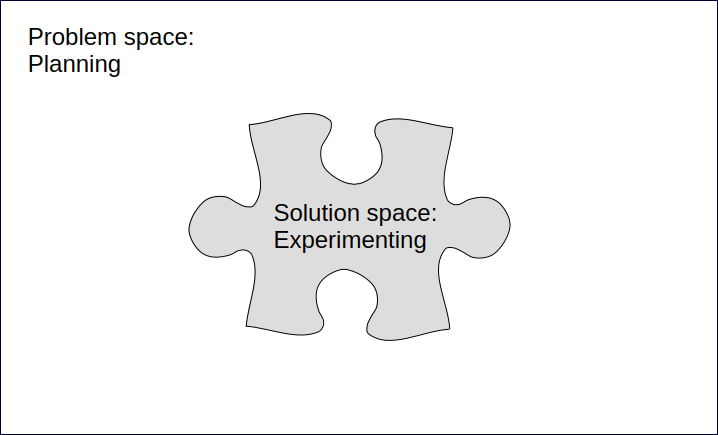
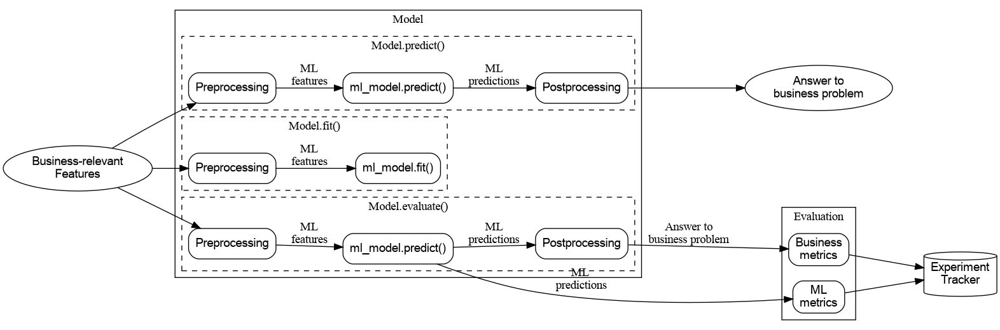

% Architecting for Experimentation
% Dan Mazur, PhD
% Discussion for AI & Machine Learning Architects

## A Working Session, Not a Lecture

**The central question:** How can architecture keep the business problem dependable while the ML solution is still being discovered?

* Audience: AI and Machine Learning Architects at a consulting firm
* Aim: leave with a boundary and interface you can explain to a client team

## The Architectural Claim

Machine learning adds a kind of change that architecture must make room for: important solution choices are discovered through experiments, not fully planned in advance.

**Architectural aim:** keep the problem and its deployment context stable enough to support fast experiments; keep experimental solution details replaceable without forcing changes downstream.

## First, Find the Boundary

The boundary separates strategic decisions that define the problem from experimental decisions made while finding a solution. It is a team agreement, not a claim that one discipline always owns every decision.

The diagram frames the problem as the stable space for planning and the solution as the space for experimentation.

## The Problem Side: Define the Destination

Problem-side decisions are those the organization cares about for their own sake:

* Business objective and intended use case
* Evaluation protocol: population, labels, time horizon, metrics, and selection rules
* Success thresholds, constraints, and acceptable trade-offs
* The business concepts that downstream systems need

Stakeholders are authorities on the destination and how success is judged. These choices should be explicit and relatively stable—not frozen forever.

## The Solution Side: Explore the Route

Solution-side choices are usually means to the agreed end:

* Features, transformations, and representation
* Algorithms, model architectures, and hyperparameters
* Post-processing and training choices
* Which hypothesis to try next, informed by evidence

The ML team needs room to test competing approaches end-to-end. A plausible idea is a hypothesis to evaluate, not automatically a binding implementation requirement.

## Where Does the Boundary Go?

**A client says:** “We need fewer high-risk accounts to reach manual review, while keeping the review team within capacity.” Which is the clearest problem-side statement?

A. Use gradient-boosted trees with recent transaction features  
B. Maximize recall at a fixed alert volume, with a stated review-capacity limit  
C. Return a calibrated probability from 0 to 1  
D. Use a two-stage model because the current rules are slow

What makes the chosen statement belong on the problem side?

## Answer and Explanation

**Best answer: B.** It describes a success measure and an operational constraint that stakeholders can evaluate across solutions.

A, C, and D prescribe or expose solution details. A probability may be a useful interface if multiple consumers need it, but it does not by itself state the business objective. The exact metric and capacity rule still need validation with stakeholders.

## What Belongs on the Problem Side?

Take a current or recent client ML initiative. Name one decision the organization cares about for its own sake and one decision it would be comfortable discovering through experiments. Where is the boundary unclear?

## Discussion Synthesis

Listen for decisions grounded in business purpose, evaluation, and constraints versus decisions about the means of achieving them. A deployment constraint can belong on the problem side when it reflects a real business requirement; a model choice is not strategic merely because it is already implemented.

The useful outcome is not a universal taxonomy. It is an explicit, shared agreement that stakeholders and the ML team can revisit when evidence or requirements change.

## Why This Is an Architecture Problem

Traditional modular architecture hides implementation details behind stable interfaces. ML adds more solution detail that may change as discovery progresses.

If a dependent service knows the current algorithm, feature set, or internal score semantics, each experiment can become a cross-system migration. A boundary designed around business concepts lets the model implementation evolve behind a contract that downstream systems understand.

## Abstract the Model, Not the Business Need

The diagram separates a model’s internal training, prediction, and evaluation processes from the business-level answer and metrics. Consumers should depend on the stable business contract, not on training internals or a particular model version.

## A Contract That Can Survive Experiments

Specify the interface in terms of the business decision it supports: inputs, meaning of outputs, operational constraints, ownership, and version/change expectations.

Avoid contracts that accidentally turn transient details into permanent dependencies:

* A named algorithm or hard-coded feature list
* A raw score whose meaning consumers must infer
* A label or metric tied to a specific UI or serving implementation

A score can be a valid interface when multiple consumers need it—but define who owns score quality, how consumers use it, and which business outcomes they own.

## Stable Interface or Model Leakage?

**A fraud service will be tried with new models and features. Which contract best limits downstream coupling?**

A. `predict_fraud_v3(user_id)` returns the v3 model’s raw logit  
B. A service returns a documented risk assessment for a transaction under a versioned business contract  
C. Each consumer imports the model package and applies the current feature mapping  
D. Consumers use the top five features as the explanation and routing rule

What business meaning must still be agreed?

## Answer and Explanation

**Best answer: B.** A stable, business-level contract can hide which algorithm and features implement the risk assessment.

It still needs a precise definition: intended use, output semantics, relevant constraints, and change/version behavior. A score or risk category is not automatically meaningful just because it has an API. A, C, and D expose choices that experiments may change.

## What Would You Put in the API?

For a churn intervention system, what must a downstream campaign service know—and what should it not need to know? What contract field would you expose, and what implementation detail would you hide?

## Discussion Synthesis

A useful contract might express a business-relevant eligibility or prioritization result, with agreed semantics and operational constraints. If consumers truly need a score, document what it means and define the score producer’s responsibilities separately from each consumer’s business action.

Feature names, model family, and hyperparameters generally belong behind the boundary. The contract should support the use case without pretending the implementation will stay still.

## The Hidden Failure Mode: Circular Dependency

When deployment is designed around the first successful model, the model choice shapes the system. Later experiments then require engineering rework; the cost of deployment pushes the team back toward the current model.

That is a circular dependency: the solution depends on the problem, but the problem’s architecture also depends on the current solution. The experiment space shrinks to what the current deployment can accommodate.

The goal is not “always build a large abstraction.” Avoid making solution-specific details part of the stable problem-side architecture when future experimentation is expected.

## The “Simple Model” Shortcut

**An early logistic regression performs well enough. The team hard-codes it into a downstream service to save time. What is the main architectural trade-off?**

A. The simpler algorithm makes business monitoring unnecessary  
B. The initial deployment may be faster, but changing algorithms/features can now require engineering changes  
C. Logistic regression cannot be replaced after deployment  
D. The team has reduced the amount of evaluation required

Which cost is being deferred?

## Answer and Explanation

**Best answer: B.** Hard-coding the model can accelerate an initial release, but it makes a solution decision part of the architecture and adds future change cost.

That is technical debt, not necessarily a wrong choice. Model simplicity does not remove the need for monitoring or evaluation; those depend on the business importance and use case. C overstates the lock-in, while D mistakes implementation choice for evaluation scope.

## Is the Abstraction Worth It?

A client needs a proof of concept in six weeks and has one likely model family. What evidence would make you choose a thin stable interface now rather than hard-coding the first model? What would make hard-coding an acceptable, explicit trade-off?

## Discussion Synthesis

Ask how likely the solution is to change, how costly a downstream rewrite would be, and whether the business use case or deployment path is still uncertain. A small business-level seam may cost less than repeated migrations; overengineering a broad framework may not.

If the team takes the shortcut, make the deferred cost and replacement trigger visible. An early model choice can be an intentional technical-debt decision, not a blanket prohibition.

## Architecture Should Make Conflict Legible

Many recurring project disagreements are boundary disagreements in disguise:

* Stakeholders prescribe a feature or algorithm; the team hears a requirement
* Goals and metrics shift, but old results are still compared as if nothing changed
* A fixed model is promised on a fixed date despite unresolved evidence
* Deployment constraints appear after experiments have optimized for something else
* Teams disagree about who owns scores, business outcomes, or technical trade-offs

Name which side a request belongs to, who decides it, and what evidence would change it.

## A Stakeholder Requests a Feature

**A stakeholder says:** “Include region from the customer’s IP address; fraud clusters geographically.” Which response best protects both expertise and experimentation?

A. Commit the feature because the stakeholder owns requirements  
B. Reject the idea because stakeholders should not discuss modeling  
C. Translate the concern into a measurable evaluation slice and test the feature as a hypothesis  
D. Add the feature only if it improves overall accuracy

What could overall accuracy conceal?

## Answer and Explanation

**Best answer: C.** Preserve the domain insight as a testable concern, define how success will be measured, and let experiments determine whether that feature helps.

Overall accuracy might conceal poor performance on geographically clustered fraud or a trade-off against fairness or another constraint. A turns a suggested means into a requirement; B discards useful stakeholder knowledge; D presumes one metric captures the goal.

## Rewrite a Prescriptive Request

How would you rewrite “use support-contact history in the churn model” as a problem-side objective plus a testable hypothesis? What comparison and guardrail would make the experiment useful?

## Discussion Synthesis

Separate the desired outcome from the proposed means. For example: “Improve identification of customers who can benefit from retention outreach, without exceeding the contact-capacity limit; test whether support-contact history improves the agreed evaluation.”

The precise metric, population, and guardrail depend on the use case. The feature remains an experiment unless the organization has a reason to require it for its own sake.

## The Metric Changes Mid-Project

**After several months, a client changes the target from “predict any failure in 30 days” to “predict actionable failures in the next 48 hours.” What is the most responsible next step?**

A. Keep the existing leaderboard and relabel the top model  
B. Treat it as a new/changed problem definition; assess data, labels, evaluation, and prior learning before comparing results  
C. Ask the ML team to pick whichever target gives better scores  
D. Change only the model threshold; the evaluation remains comparable

What needs revalidation?

## Answer and Explanation

**Best answer: B.** The new horizon and actionability criterion may change the labels, data requirements, metric meaning, and which solution works.

Prior experiments can still be informative, but should not be assumed comparable or valid under the new definition. Revalidate the evaluation protocol and relevant learnings; the shift may be small or may invalidate much of the previous progress.

## How Do You Make a Goal Change Safe?

A sponsor has a legitimate new business insight late in the project. What should the team record before changing the target? How would you preserve useful learning without pretending results are apples-to-apples?

## Discussion Synthesis

Capture the old and new problem definitions, why the change is valuable, changes to population/labels/time horizon/metrics/use case, and the validation work that follows. Keep old results tied to the old protocol; compare across definitions only where a defensible bridge is established.

The boundary is not a ban on change. It makes the impact of a problem-side change visible so the team can make it deliberately.

## Stable Does Not Mean Frozen

A stable problem definition makes repeated experiments comparable and accumulates useful learning. It should represent a durable business challenge, not a point-in-time interface layout or backend implementation.

When evidence reveals a mistaken assumption, revisit the definition. Expect to recheck data requirements, labels, features, model choices, metrics, and prior conclusions. The cost depends on the magnitude of the change.

## What Makes a Metric Durable?

**An e-commerce recommender is evaluated by “clicks on the first six visible items.” A product redesign changes the number and layout of visible items. What is the architectural concern?**

A. A model metric should never include user behavior  
B. The evaluation may be coupled to a point-in-time UI, weakening comparisons after redesign  
C. The new UI guarantees that offline metrics are invalid  
D. The team should freeze the UI until the model is retired

How could the evaluation better express the business need?

## Answer and Explanation

**Best answer: B.** If the metric depends on a particular screen layout or scroll behavior, a UI change can change the meaning of the evaluation.

A durable problem definition avoids dependence on point-in-time UI/backend details. A measure should reflect the intended business outcome and use case, while the team validates how interface changes affect measurement. A and C overstate the issue; D confuses stable evaluation with frozen product design.

## What Should Stay Comparable?

Which population, time horizon, labels, serving filters, or product details could silently change the meaning of a model metric used in your consulting work? What belongs in the evaluation protocol?

## Discussion Synthesis

Look for the complete protocol, not just a metric name: what examples are included, how labels and time windows are defined, how constraints and selection rules apply, and what serving-layer behavior affects measurement.

Durability does not mean ignoring meaningful user or product changes. It means making changes explicit and deciding whether old and new evaluations can fairly be compared.

## A Deployment Constraint Arrives Late

**After offline experiments, the platform team says predictions must be available within 50 ms and cost less than $1,000/month. What does the architecture lesson suggest?**

A. Latency and cost are always solution-side, so disregard them until model selection  
B. Treat relevant deployment constraints as part of business understanding and evaluation; revisit prior experiments against them  
C. Choose the most accurate model and ask platform to accommodate it  
D. These constraints prove the project should not use ML

How would you avoid a late surprise next time?

## Answer and Explanation

**Best answer: B.** The use case and deployment scenario should shape the problem definition early; meaningful technical constraints can be success criteria or rejection thresholds.

Past models may still offer learning, but their suitability must be re-evaluated. Latency and infrastructure cost are examples of constraints that can shape model selection. A ignores end-to-end trade-offs; C assumes resources; D jumps to a conclusion.

## Where Does Deployment Begin?

A team has a promising offline prototype but no serving owner, latency budget, or monitoring plan. In a consulting engagement, which questions and owners must be brought in during business understanding rather than after model selection?

## Discussion Synthesis

Clarify the actual use case, decision timing, inputs available at prediction time, latency/cost constraints, deployment and maintenance ownership, and how success will be monitored. The whole lifecycle matters; a model that cannot serve the agreed use case is not a successful solution to it.

You need not design every production detail before experimentation. You do need enough of the deployment scenario to avoid optimizing toward an unusable target.

## Who Owns the Decision?

**One score feeds fraud review, account holds, and customer outreach, each owned by a different team. What is the strongest responsibility design?**

A. The ML team owns all business outcomes because it emits the score  
B. The ML team owns score quality under an agreed contract; each consuming team owns its decision and business impact  
C. No team owns outcomes until the model is fully autonomous  
D. Let each consumer reinterpret the score without documenting its meaning

What must the score owner and consumers agree?

## Answer and Explanation

**Best answer: B.** A shared score interface can work when responsibilities remain explicit: the producing team is accountable for score quality, while consumers own how they use it and the resulting business impacts.

Agree on score semantics, quality measures, handoffs, and consumer-specific decision policies. A overextends model-team ownership; C and D create accountability gaps.

## Draw the Ownership Map

For a credit-risk score consumed by underwriting and collections, who owns score quality, threshold/policy, fairness constraints, latency, and business outcome? Where would you expect a conflict?

## Discussion Synthesis

There is no one-size-fits-all org chart, but there must be explicit accountable owners and metrics. If the ML team’s contract is score quality alone, consumers own their decisions; if the ML team is accountable for an end-to-end use case, its responsibilities and authority must include relevant technical and business trade-offs.

Technical performance such as latency can also be a trade-off the modeling team needs to assess. Clarify shared dependencies rather than leaving them in the gaps.

## Promising a Model by a Date

**A sales lead promises a client “a model with 95% precision in eight weeks,” before data understanding. What is the safer architectural commitment?**

A. Guarantee the precision because a fixed delivery date requires a fixed metric  
B. Commit to an experiment plan, decision gates, and a jointly defined success protocol; report evidence and uncertainty  
C. Ask the ML team to choose a more achievable metric after training  
D. Avoid milestones because ML is experimental

What can be promised responsibly?

## Answer and Explanation

**Best answer: B.** Experimental outcomes cannot be responsibly guaranteed before the problem, data, and evaluation are understood. A team can commit to learning milestones, transparent evidence, and decision points.

The goal is not to avoid accountability. Define what the team will learn and deliver, who decides whether results meet the agreed criteria, and what options follow. A promises an outcome without evidence; C moves the goalposts; D confuses uncertain results with unstructured work.

## Turn a Delivery Promise into a Learning Plan

A client contract asks for a production-ready model in one quarter, but data access and labels are uncertain. What milestones, decision rights, and fallback options would you propose without pretending the performance outcome is known?

## Discussion Synthesis

Separate controllable work from uncertain findings: clarify the objective and evaluation, establish data access/quality, run a baseline, test feasibility, and hold explicit decisions on whether to continue, reframe, or use a simpler non-ML option.

A plan can include deployment preparation and a date; it should not imply that experiments guarantee a performance threshold. Align contract language and stakeholder expectations with evidence and dependencies.

## The Boundary in the ML Lifecycle

CRISP-DM distinguishes business understanding from later modeling and evaluation:

1. Define the problem, boundary, use case, and deployment scenario.
2. Understand data and prepare it for the defined evaluation.
3. Experiment with models and evaluate under the agreed protocol.
4. Deploy and maintain; use findings to revisit earlier assumptions when needed.

Phases are a guard against speculative work becoming hidden commitment—not a ban on feedback. Later evidence can send the team back to earlier decisions.

## Does a New Experiment Change the Problem?

**The ML team tries a transformer model, new features, and a different regularization setting while keeping the agreed use case and evaluation protocol. What changed?**

A. The problem definition necessarily changed  
B. The solution space changed; results remain comparable if the protocol was applied consistently  
C. The stakeholders must approve each experiment because the metric is stable  
D. The model is invalid unless deployment is redesigned first

What evidence would make you revisit the problem side?

## Answer and Explanation

**Best answer: B.** These are experimental solution changes under the same problem definition. They can be compared when the evaluation protocol and relevant conditions remain consistent.

If evidence reveals a flaw in the target, labels, constraints, or use case, revisit the problem side explicitly. That is different from asking permission for every model iteration.

## When Should the Team Go Back a Phase?

An evaluation shows poor generalization. What evidence would justify revisiting data preparation, and what evidence would suggest the problem definition or evaluation itself needs review?

## Discussion Synthesis

Poor performance can have several causes; diagnose rather than relabel. Data quality, leakage, representativeness, and preparation may warrant returning to data work. A target that cannot support the intended action, inconsistent labels, or a metric misaligned with business value may warrant revisiting business understanding.

CRISP-DM includes backward movement. The important discipline is to record what changed and re-establish comparability before presenting a new result as an improvement.

## Is Model Complexity the Problem?

**A client objects to a complex model. Which response best applies the boundary?**

A. Treat low complexity as a universal requirement  
B. Ask what business concern complexity represents—such as latency, interpretability, or memory—and encode that concern as a measurable constraint if needed  
C. Dismiss the concern because complexity is always an implementation detail  
D. Select the most complex model to preserve experimental freedom

Which concerns are intrinsically valuable to this organization?

## Answer and Explanation

**Best answer: B.** Complexity alone may not matter to the organization; it may be a proxy for an outcome that does matter.

If interpretability, latency, or memory has business significance, define the relevant requirement and evaluate solutions against it. If not, model complexity is usually an experimental choice. Neither unconditional simplicity nor unconditional complexity addresses the real concern.

## Translate the Proxy

A client says, “We need an explainable model.” What questions would distinguish a genuine decision requirement from a preference for a familiar algorithm? How could the answer affect architecture and evaluation?

## Discussion Synthesis

Clarify who needs an explanation, for what decision, at what time, and what evidence would make it adequate. A genuine use-case or regulatory constraint belongs in the problem definition and may shape both evaluation and interface; a preferred algorithm is one possible means, not proof the requirement is met.

Make the decision and acceptance criteria explicit. “Explainable” without a user, purpose, or test can create disagreement rather than control.

## What Is the Baseline?

**A new ML model beats the previous ML model in offline evaluation. What comparison best answers whether it solves the business problem better?**

A. Compare only the two ML models; non-ML solutions are out of scope  
B. Compare candidate approaches, including the current process or a simple heuristic, under a shared problem definition and evaluation  
C. Compare the candidate’s training loss with the previous model’s test score  
D. Select the newest model because it reflects the latest data

What must be held consistent for a fair comparison?

## Answer and Explanation

**Best answer: B.** The problem should be framed so candidate solutions can be scientifically compared—including manual effort, a heuristic, conventional engineering, or ML where relevant.

Use the same agreed evaluation and constraints. A good model is not automatically more useful than the current process; training loss and test score are not directly comparable; recency alone is not evidence of business value.

## Consulting Case — Maintenance Triage

A manufacturer wants to reduce unplanned downtime. Early workshops produce three proposals: classify failures within 30 days, predict time-to-failure, or prioritize machines for an inspection queue. The client asks for a dashboard “with the model’s confidence.” Data labels are inconsistent; inspections are capacity-limited; a deployment platform has a latency budget.

Your team has two weeks to recommend an architecture and discovery plan.

## Case Discussion — Build the Boundary

What architecture and discovery plan would you recommend?

* What is the business problem and intended decision, and what remains unresolved?
* What evaluation protocol and operational constraint would you use?
* What stable contract should the inspection queue consume?
* Which experiment would you run, and what risk of premature commitment would you watch for?

## Case Discussion — Expert Synthesis

Start with the decision the company needs to make—such as which machines to inspect within limited capacity—rather than choosing a prediction target before confirming what is actionable. Agree on labels, time horizon, evaluation population, and selection criteria with domain experts.

The queue can consume a business-level prioritization or risk assessment under a clear contract. Treat 30-day classification, time-to-failure, and alternative features as hypotheses until evaluated. Include latency and inspection capacity as relevant constraints; expose uncertainty only with agreed meaning. If the target changes, assess what prior data and results still support.

## Architecture Review: Six Questions to Ask

1. What decision or business outcome is the system meant to support?
2. How will stakeholders judge success, including constraints and trade-offs?
3. Which facts belong in the durable contract, and which are experimental?
4. Can a new model or heuristic be substituted without consumer rewrites?
5. Who owns the output’s quality, downstream action, and business impact?
6. What changes would redefine the problem—and what prior evidence would need revalidation?

## Where Does Your Boundary Leak?

Think of a system you have designed or reviewed. Which downstream dependency most tightly couples a consumer to model internals? What is the smallest contract change that would reduce that coupling without building a general-purpose platform?

## Discussion Synthesis

Common leaks include model-version-specific fields, a score with undocumented semantics, consumer-owned feature preprocessing, and evaluation tied to implementation details. The smallest useful change is often a clear business-level output contract plus explicit ownership and change expectations.

Keep the solution free to evolve, but avoid abstracting beyond the actual use case. Architecture is valuable when it reduces the cost of likely change.

## What Conflict Would You Surface Earlier?

Which recurring disagreement—feature prescriptions, shifting metrics, deployment readiness, or ownership—would benefit most from making the problem-solution boundary explicit? What one sentence could a team add to its project brief?

## Discussion Synthesis

Name the decision and its owner, not just the tension. For example: “Stakeholders own the evaluation objective and constraints; the ML team proposes and tests solution hypotheses against them; a material objective change triggers an impact review of data and prior results.”

The exact wording should fit the engagement. A boundary is useful only when the people making and implementing decisions share it.

## How Would You Know It Worked?

After deployment, what signals would tell you the architecture is supporting experimentation rather than just hosting a model? What would you inspect at the next model replacement?

## Discussion Synthesis

Look for whether a model or feature experiment can be evaluated and substituted without downstream redesign; whether business-level outputs remain understood; whether teams can trace each result to the applicable problem definition; and whether ownership for monitoring and action is clear.

An abstraction is not successful merely because the API stayed stable. It should preserve the agreed business meaning and allow evidence-led changes with bounded impact.

## What to Take Back to a Client

* Define the destination before prescribing the route.
* Make the problem-solution boundary explicit and build stable, business-level contracts around it.
* Keep evaluation, use case, and deployment constraints aligned; treat meaningful problem changes as changes to validate.
* Convert proposed solutions into hypotheses; preserve room for experimentation.
* Make ownership and trade-offs visible so architecture prevents recurring conflict instead of encoding it.

## Closing Discussion

What is one decision in your next ML engagement that you will explicitly place on the problem side—and one you will keep open for experimentation?
